# SignBridge AI: An Intelligent Sign Language Recognition and Communication System
### Project report

> **Status of the evidence.** All measured results in this report come from a **synthetic landmark dataset** used to build and
> test the pipeline. No real PSL/ASL dataset was available in the build environment and the live camera path could not be run
> there. Results on real sign-language data are therefore **not reported**; Section 6 states exactly what remains to be measured.

## 1. Abstract
SignBridge AI is a laptop-webcam application that recognises Pakistan Sign Language (PSL) and American Sign Language (ASL),
turns signs into text and speech, and lets a hearing person reply through speech or typing, which is shown as text and as an
animated reference sign. The system extracts 21 hand landmarks per hand with the MediaPipe Tasks HandLandmarker, normalises them
(wrist-relative, palm-scaled, handedness-canonical), and classifies static signs with a Random Forest and a small MLP and dynamic signs
(30-frame sequences) with an LSTM and a GRU compared in an ablation. A stability filter, language router (PSL/ASL/Auto),
sentence builder, offline text-to-speech and a practice mode complete a Streamlit interface. Because datasets are not bundled, the project
ships a demo model trained on synthetic landmarks; on that synthetic data signer-held-out test accuracy is between
0.958 and 1.000, which demonstrates a working pipeline but says nothing about real sign-language performance.

## 2. Problem statement
Deaf and hard-of-hearing people in Pakistan and elsewhere communicate in sign languages that most hearing people do not know. Goal:
a low-cost, camera-only, real-time system that (i) recognises signs from a standard webcam, (ii) outputs text and speech,
(iii) supports the reverse direction, and (iv) supports PSL, for which public data is scarce, by allowing users to record their own training samples.
Constraints: laptop CPU only, no depth sensor, no wearable, responsive video, and honest, signer-independent evaluation.

## 3. Literature background
*(Summarised from the author's general knowledge; check the references before submission.)*
* **Hand tracking.** MediaPipe Hands (Zhang et al., 2020) provides real-time 21-point 3-D hand landmarks from RGB video on CPU,
  making landmark-based recognition practical; the Tasks API (`HandLandmarker`) is its current interface.
* **Datasets.** ASL Alphabet (Kaggle image set of fingerspelled letters), WLASL (Li et al., WACV 2020; word-level ASL videos, many source links now dead),
  MS-ASL (Joze & Koller, 2019). Pakistan Sign Language resources exist from academic groups (e.g. LUMS/CHISEL and dynamic-PSL collections) but may require author access.
* **Sequence models.** LSTM (Hochreiter & Schmidhuber, 1997) and GRU (Cho et al., 2014) are standard for isolated-sign classification from landmark sequences; transformers and
  graph networks (skeleton-based) are common stronger alternatives with more data.
* **Classical baselines.** Random Forests (Breiman, 2001) are a robust baseline on tabular landmark features.
* **Evaluation caveat.** Sign-language recognition results are frequently inflated by signer overlap between train and test; signer-independent evaluation is the meaningful measure,
  and this project implements it by splitting on signer ids.

## 4. Methodology

### 4.1 Pipeline

```mermaid
flowchart LR
  CAM[Webcam frame<br/>streamlit-webrtc] --> FLIP[Mirror / selfie view]
  FLIP --> DET[MediaPipe HandLandmarker<br/>21 landmarks x 2 hands]
  DET --> SLOT[Hand slots<br/>Right / Left + mask]
  SLOT --> NORM[Normalise<br/>wrist-relative, palm-scaled,<br/>mirror left, canonical slot]
  NORM --> MOT{Motion score<br/>over 15 frames}
  MOT -- low --> STAT[Static models<br/>RF / MLP per language]
  MOT -- high --> DYN[Dynamic models<br/>LSTM / GRU per language<br/>last 1 s resampled to 30 frames]
  STAT --> ROUTE[Language router<br/>PSL / ASL / Auto 3 s mean conf]
  DYN --> ROUTE
  ROUTE --> STAB[Stability filter<br/>N frames, threshold, unknown, cooldown]
  STAB --> SENT[Sentence builder<br/>+ gloss clean-up]
  SENT --> TTS[pyttsx3 TTS thread]
  SENT --> UI[Streamlit UI<br/>history, charts, CSV]
  MIC[Hearing person<br/>speech / typing] --> STT[Speech-to-text] --> UI
  UI --> ANIM[Text to sign<br/>reference landmark animation]
  PRAC[Practice mode<br/>similarity to reference] --- NORM
```

### 4.2 Feature engineering
Landmarks are stored raw as `(2, 21, 3)` slots (Right, Left) plus a presence mask; models never see pixels. Normalisation: subtract the wrist, divide by palm size
(wrist→middle-finger MCP), mirror the Left slot to a canonical right hand, and move a lone left hand into slot 0 so one-handed signs are identical for either hand.
Static feature = 126 shape values + 2 presence flags (128). Dynamic frame feature adds the palm-normalised, mean-centred wrist trajectory
(mirrored for the Left slot) → 132 per frame, 30 frames. Orientation is not normalised away (it distinguishes signs) and is instead covered by augmentation.

### 4.3 Augmentation (training split only)
Three augmented copies per sample: random in-plane rotation (±15°), scale jitter (±10 %), Gaussian landmark noise (σ = 0.004), and x-mirroring
*without* slot swap (simulates handedness mislabelling by the detector).

### 4.4 Models
* Static: Random Forest (200 trees, balanced class weights) and a Keras MLP (128-64, dropout, softmax), one set per language.
* Dynamic: LSTM (64 units, 52,677 parameters) vs GRU (64 units, 40,261 parameters); identical data, split, seed, optimiser, early stopping and LR schedule.
* Split: signer-disjoint train/validation/test with `GroupShuffleSplit`; fallback to a stratified random split (reported as not signer-independent) when fewer than 3 signers exist.

### 4.5 Real-time logic
*Static/dynamic switching:* a motion score (largest temporal standard deviation of smoothed wrist position and fingertip extensions in palm units, 15-frame window) above a threshold selects the dynamic model for at least 0.6 s.
*Stability filter:* commit after N consecutive agreeing frames above the threshold; `unknown` and low confidence reset the streak; a cooldown blocks commits, and the same sign cannot
commit again until a release (different sign, unknown, or hand removed).
*Auto language:* mean top-confidence per language over the last 3 s with a hysteresis margin; manual selection overrides.

### 4.6 Demo data
`core/synthetic.py` generates a parametric hand (finger curl, thumb position, spread) with per-signer hand size, finger proportions, curl bias, rotation and handedness (every third signer left-handed).
Static ASL demo classes are 7 finger patterns plus `unknown` (in-between postures); PSL demo classes are neutral ids `P1–P6` plus `unknown`; dynamic demo classes are five motion patterns
(`WAVE, CIRCLE, NOD, SWIPE, PINCH`). These are **not real signs**.

## 5. Experiments and results (synthetic data)

Setup: 8 virtual signers per language → 4 train / 2 validation / 2 test signers. Static: 2,880 (ASL) / 2,560 (PSL) samples; dynamic: 1,200 sequences per language (600 train / 300 val / 300 test).
Single-core CPU, TensorFlow-CPU. All values are copied from `reports/demo/metrics.json`.

| Language | Type | Model | Test accuracy | Macro-F1 | Model latency (ms/sample) | Split | n_test |
|---|---|---|---|---|---|---|---|
| PSL | static | RF | 0.961 | 0.966 | 8.01 | cross_signer (SYNTHETIC) | 640 |
| PSL | static | MLP | 0.958 | 0.963 | 1.66 | cross_signer (SYNTHETIC) | 640 |
| PSL | dynamic | LSTM | 0.990 | 0.990 | 40.95 | cross_signer (SYNTHETIC) | 300 |
| PSL | dynamic | GRU | 1.000 | 1.000 | 50.57 | cross_signer (SYNTHETIC) | 300 |
| ASL | static | RF | 1.000 | 1.000 | 8.84 | cross_signer (SYNTHETIC) | 720 |
| ASL | static | MLP | 1.000 | 1.000 | 2.14 | cross_signer (SYNTHETIC) | 720 |
| ASL | dynamic | LSTM | 0.997 | 0.997 | 47.61 | cross_signer (SYNTHETIC) | 300 |
| ASL | dynamic | GRU | 1.000 | 1.000 | 49.82 | cross_signer (SYNTHETIC) | 300 |

| Language | Type | Pipeline mean (ms/frame) | p95 (ms) | FPS (pipeline only) |
|---|---|---|---|---|
| PSL | static | 1.98 | 2.09 | 505 |
| PSL | dynamic | 13.35 | 46.69 | 75 |
| ASL | static | 1.98 | 2.10 | 505 |
| ASL | dynamic | 12.31 | 37.08 | 81 |

### 5.1 Ablation: LSTM vs GRU
Same data, split and hyper-parameters. Test accuracy: PSL: LSTM 0.990 vs GRU 1.000; ASL: LSTM 0.997 vs GRU 1.000. Training time to early stop: PSL: LSTM 38 s, GRU 32 s; ASL: LSTM 63 s, GRU 43 s. With 2 held-out signers and a task this easy, a difference of a
few hundredths is not statistically meaningful; no claim is made that one architecture is better.

### 5.2 Static (RF vs MLP)
Test accuracy: PSL: RF 0.961 vs MLP 0.958; ASL: RF 1.000 vs MLP 1.000. MLP inference is about 4–5× faster per sample than the Random Forest in these runs (see table); both are far inside the real-time budget.

### 5.3 Engineering findings from the experiments (all real, from this build)
1. **Handedness bug found by end-to-end testing.** Offline accuracy was high, but when 40 simulated gestures were replayed through the live engine only 36 committed correctly:
   all 4 failures were left-handed virtual signers on `WAVE`/`CIRCLE`. Root cause: presence flags and the wrist trajectory were slot-specific, so a left-handed signer produced feature vectors the model had not seen
   (the left-handed signers had landed in held-out splits). Fix: canonical slot placement and a mirrored left-slot trajectory, plus regression tests. After retraining, 40/40 gestures commit correctly.
2. **Frame-delta motion measures fail.** A mean frame-to-frame feature-change score could not separate a held pose with realistic landmark jitter from real motion. Replacing it with the smoothed temporal spread
   of low-noise signals gave: held pose (σ = 0.004) ≤ 0.09 (max over 56 held poses), dynamic windows with a 5th percentile ≥ 0.17 for WAVE/CIRCLE/NOD/SWIPE, but only 0.095 for PINCH, so the shipped threshold 0.14
   trades some PINCH-type (shape-only) motions for fewer false dynamic switches. A manual override exists.
3. **Premature static commits.** In Auto mode the first frames of a moving sign were committed as a static letter before motion was visible; static commits are now withheld until the motion window is full.
4. **Import-order crash.** Importing `mediapipe`/`tensorflow` before `streamlit_webrtc` segfaults on the tested setup; the safe order is enforced in `core/compat.py`.

### 5.4 Speed
Pipeline-only latency (features → models → stability, camera and MediaPipe excluded): static ≈ 2 ms/frame (≈ 500 FPS), dynamic ≈ 12–13 ms/frame mean with p95 of 37–47 ms on the frames where the recurrent model runs
(≈ 75–81 FPS pipeline-only). MediaPipe hand-detector latency was **not measured** (model download blocked in the build environment); end-to-end webcam FPS is therefore unknown and must be measured on the target laptop.

## 6. Discussion
The architecture is sound and fully testable without hardware: every stage downstream of the landmarks was verified with real code runs, including signer-disjoint evaluation, handedness invariance, stability/cooldown behaviour and the UI.
What is **not** known: accuracy on real PSL/ASL signs, performance with real webcam jitter and lighting, real MediaPipe handedness behaviour, and true end-to-end FPS. The near-perfect synthetic numbers reflect an easy, low-dimensional
generated task, not model quality. The LSTM/GRU ablation and RF/MLP comparison must be repeated on real data, ideally with ≥ 10 signers and repeated random signer splits to report variance.

## 7. Limitations
* Synthetic demo model; real datasets not bundled; PSL data may need author access.
* Live camera / real MediaPipe path untested in the build environment.
* Hand landmarks only: no body pose, facial expressions or mouthing, which carry meaning in real sign languages; two-handed and body-contact signs are weak.
* Motion threshold and dynamic window (1 s) are calibrated on synthetic data and a duration assumption.
* ASL Alphabet has no signer ids (no signer-independent test) and J/Z are motion letters represented as stills.
* Isolated signs only; no continuous sign-language translation or grammar; gloss→sentence is rule-based (or optional LLM).
* Text→sign shows landmark skeleton animation, not a human signer.
* Speech-to-text needs internet (or optional Whisper); Urdu TTS needs an OS voice.

## 8. Future work
Collect a multi-signer PSL dataset with the recorder tool and publish it; add body/face landmarks (MediaPipe Holistic-style) and a transformer/graph model; continuous recognition with CTC; per-user calibration of thresholds;
learned (rather than rule-based) gloss-to-sentence; avatar or video-based sign synthesis for the reverse direction; on-device mobile deployment; user studies with Deaf community members.

## 9. Reproducibility
`python scripts/build_demo.py` reproduces every table and figure above (seed 42, `config.yaml`). Environment: Python 3.12.3, mediapipe 1.2.2, tensorflow-cpu 2.21.0, keras 3.15.1, scikit-learn 1.9.1, streamlit 1.67.0, streamlit-webrtc 0.79.1.
Absolute timings vary by machine.

## References (verify before submission)
Zhang et al., *MediaPipe Hands: On-device Real-time Hand Tracking*, 2020. · Li et al., *Word-level Deep Sign Language Recognition from Video (WLASL)*, WACV 2020. · Joze & Koller, *MS-ASL*, BMVC 2019. ·
Hochreiter & Schmidhuber, *Long Short-Term Memory*, Neural Computation 1997. · Cho et al., *Learning Phrase Representations using RNN Encoder-Decoder*, EMNLP 2014. · Breiman, *Random Forests*, Machine Learning 2001.
