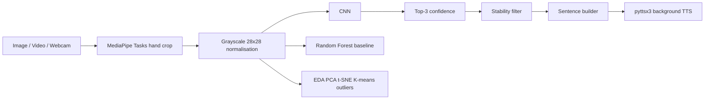

# SignBridge AI Project Report

## Abstract

SignBridge AI recognises 24 static ASL letters from the real Sign Language
MNIST dataset and returns text and offline speech. It supports image upload,
video upload, and live webcam input. A small augmented CNN is compared with a
Random Forest baseline, while a data-mining workflow reports class balance,
PCA, t-SNE, K-means purity, pixel importance, and outliers.

## Problem

Sign Language MNIST contains centred 28x28 hand crops, while webcam frames have
different lighting, scale, background, and signer appearance. The project
therefore reports official test performance and separately supports evaluation
on images recorded by the user.

## Architecture



## Method

`scripts/train_image.py` reads only the supplied training CSV for fitting and
uses the official test CSV only for evaluation. The CNN uses rotation and zoom
augmentation, dropout, and three convolutional blocks. The baseline uses
balanced Random Forests on flattened pixels. Metrics include accuracy,
macro-F1, per-class precision/recall/F1, and inference time.

`scripts/data_mining.py` uses real training rows to create class-balance,
PCA/t-SNE, K-means cluster purity, Random Forest pixel importance, and
Isolation Forest outlier reports.

## Results

Results are deliberately generated rather than hard-coded. Run:

```bat
python scripts\train_image.py
python scripts\data_mining.py
```

Then read `reports/metrics.json`, `reports/results_table.md`, and
`reports/mining_summary.json`. Confusion matrices are saved in `reports/`.

## Limitations

The official split may share signers with training, so its score can be
optimistic. Camera performance can be lower because of domain shift. J and Z
are absent because they require motion. The system recognises isolated static
letters, not continuous words, facial expression, body pose, or full sign
language grammar.

## Future work

Collect multiple held-out signers, fine-tune with recorded webcam crops, add
temporal models for J/Z and words, and evaluate with a published
signer-independent protocol.
